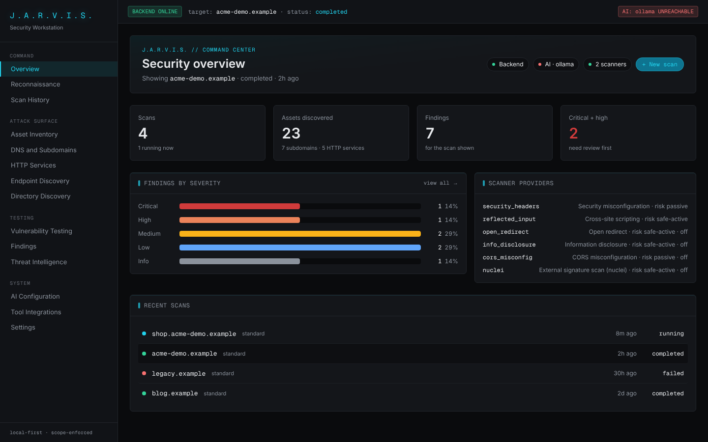
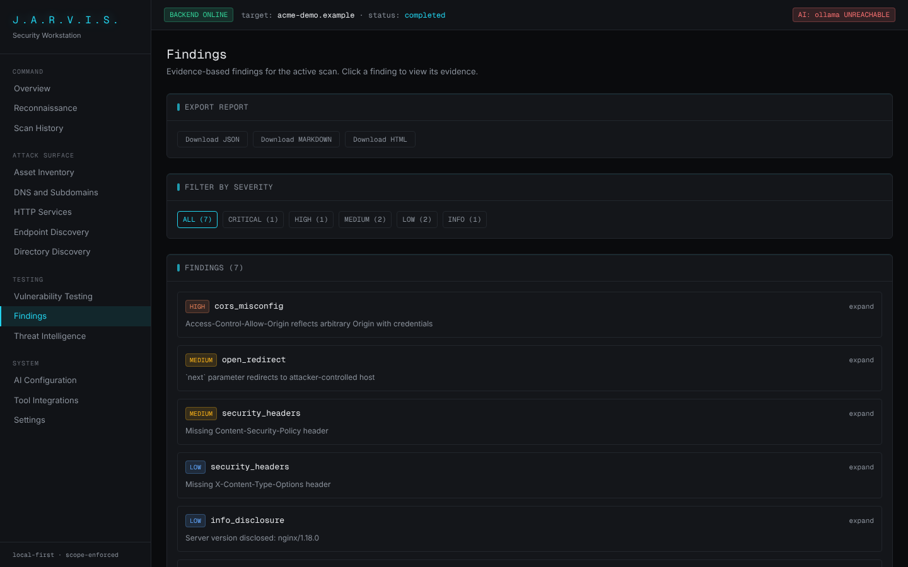
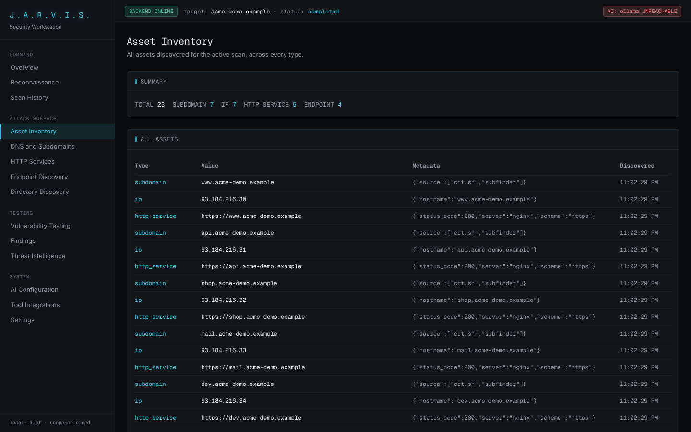
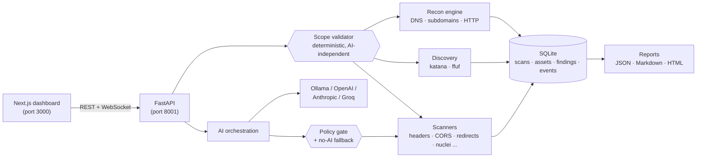

<div align="center">

# J.A.R.V.I.S.

**Joint AI Reconnaissance, Vulnerability Intelligence and Security**

A local-first, AI-assisted security workstation for **authorized** reconnaissance
and evidence-based web vulnerability testing.


-white)




</div>

## Why it's different

Most "AI pentest" tools let a language model decide what to attack. JARVIS
doesn't. The AI **proposes**, and plain, deterministic code **decides**:

- 🛡️ **Scope is enforced without the AI.** Every target, and every host
  discovered along the way, is checked against a hardcoded blocklist
  (private, loopback, link-local, reserved, multicast, cloud metadata).
  Hostnames are resolved and blocked if *any* of their addresses is
  internal, and re-checked right before each network step. No prompt can
  talk its way around this.
- 🧠 **AI output is never trusted directly.** Each AI-proposed action passes
  `app/orchestration/policy.py`'s hard rules (allowed action types,
  confidence range, scope membership, budget).
- 🔁 **Works with no AI at all.** If the model is unreachable or returns
  junk, a deterministic ranking (`app/orchestration/fallback.py`) takes
  over and the event log says so.
- 🏠 **Local-first.** Inference runs on your machine through Ollama by
  default. Cloud providers are off unless you turn them on.

## Features

| Area | What it does |
|---|---|
| **Reconnaissance** | DNS records, passive subdomains (crt.sh, subfinder, amass), bulk resolution (dnsx), HTTP service probing |
| **Discovery** | Endpoint crawling (katana) and directory/file discovery (ffuf) |
| **Vulnerability testing** | Security headers & cookie flags, canary-based reflected input, open redirect, CORS misconfiguration, information disclosure, Nuclei templates |
| **AI orchestration** | Ollama (default), OpenAI, Anthropic, or Groq behind one provider interface, always behind the policy gate |
| **Live monitoring** | WebSocket event stream backed by a persisted log, so a reconnecting browser recovers full history |
| **Reporting** | Deduplicated, evidence-backed findings exported as JSON, Markdown, or HTML |
| **Dashboard** | Next.js GUI: overview, severity breakdown, asset inventory, findings triage, scan history, AI and tool config |

<table>
  <tr>
    <td></td>
    <td></td>
  </tr>
  <tr>
    <td align="center"><sub>Findings triage with severity filters and report export</sub></td>
    <td align="center"><sub>Asset inventory for a scan</sub></td>
  </tr>
</table>

## Architecture



- **Backend:** FastAPI + SQLAlchemy 2.x + Alembic, SQLite by default
- **Frontend:** Next.js 16 (App Router) + React 19 + Tailwind v4
- **AI:** one provider interface over Ollama, OpenAI, Anthropic and Groq
- **External tools (optional):** subfinder, amass, dnsx, katana, ffuf, nuclei

## Quick start

```bash
./setup.sh   # Python venv, migrations, npm install, pulls the default Ollama model
./start.sh   # backend on :8001, frontend on :3000
```

Then open `http://<this machine's IP>:3000`. The frontend resolves its API
address from `window.location`, so it also works from a host machine reaching
into a VM.

<details>
<summary>Running the two halves by hand</summary>

**Backend** (port 8001):
```bash
cd backend
source venv/bin/activate
uvicorn app.main:app --host 0.0.0.0 --port 8001 --reload
```

**Frontend** (port 3000):
```bash
cd frontend
npm run dev
```
</details>

### Configuration

All config lives in `backend/.env` (see `backend/.env.example`). Nothing
secret is ever returned by `/api/settings`; API keys are reported only as
`*_api_key_configured: true/false`.

| Setting | Purpose |
|---|---|
| `API_KEY` | Protects every API route. **Set it before exposing JARVIS beyond localhost.** |
| `OLLAMA_BASE_URL`, `OLLAMA_DEFAULT_MODEL` | Local AI (the default path) |
| `ENABLE_CLOUD_AI`, `CLOUD_AI_PROVIDER` | Off by default. Set `true` plus `openai`, `anthropic` or `groq` and the matching API key. Restart after changing. |
| `ENABLED_SCANNERS` | Comma-separated list of active scanners; empty enables all |
| `ORCHESTRATION_BUDGET` | Max AI/fallback action proposals per scan |
| `EXTERNAL_TOOLS_ENABLED`, `EXTERNAL_TOOLS_BIN_DIR` | Use subfinder/amass/dnsx/katana/ffuf/nuclei from this directory |
| `NUCLEI_TEMPLATES_SEVERITY`, `FFUF_WORDLIST_PATH` | Tune nuclei and ffuf |

## Tests

```bash
cd backend
source venv/bin/activate
pip install -r requirements-dev.txt   # once
pytest tests/ -v
```

76 regression tests cover scope enforcement (the safety-critical path,
including hostnames that resolve to internal addresses), the deterministic
policy gate, the no-AI fallback, redirect safety, finding deduplication, the
scan lifecycle state machine, the external-tool adapters, and report
generation (including HTML escaping, checked against a deliberately malicious
finding). Tests use an isolated SQLite file and never touch real DNS or the
real `jarvis.db`.

Restart/recovery has been live-verified: restarting the backend against real
scan data (7 scans, 949 assets) preserved every scan, its status, and its
full asset/finding/event history.

## Status

**Implemented:** everything in the feature table above.

**Not yet implemented:** threat-intelligence enrichment (CVE correlation,
reputation lookups). Its page in the GUI says so plainly and shows no fake
data. OWASP ZAP is not integrated.

## Known limitations

- `llama3.2:3b` (the default local model) does not reliably produce valid
  JSON for the orchestration prompt; the deterministic fallback takes over
  and is logged in the scan's event trail. A larger, instruction-tuned model
  does better.
- The WebSocket stream is a 1-second DB-polling bridge, not true pub/sub.
  Fine at this scale; it would need rework for many concurrent scans.
- Scope checks re-resolve hostnames right before each step, which narrows
  but does not fully close the DNS-rebinding window: the external tools
  resolve names again themselves.
- Duplicate asset values across different asset types can collide in the
  orchestrator's internal attribution map. Cosmetic only; it doesn't affect
  scope enforcement or findings.
- `HEAD` requests to the report export endpoint return 405; `GET` works.
- Cloud AI changes require editing `.env` and restarting. There's no in-app
  settings writer, by design (keeps secrets out of the database and git).

## Responsible use

Only scan systems you own or have explicit written permission to test.
JARVIS enforces scope technically, but authorization is your responsibility.
